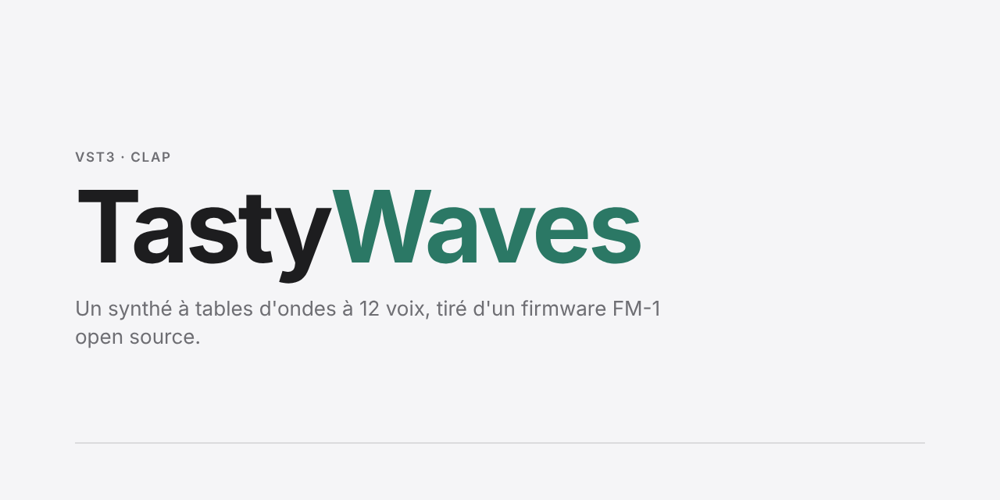

# fm1-plugins

Plugins VST3 et CLAP tirés de firmwares FM-1 open source, en Rust avec [nih-plug](https://github.com/robbert-vdh/nih-plug).

Premier plugin prévu : **TastyWaves**, synthé à tables d'ondes à 12 voix (firmware de [marksweiss/tastywaves](https://github.com/marksweiss/tastywaves)).

## Statut

Démarrage du projet : le dépôt, la licence et la page de présentation sont en place, le code du plugin n'est pas encore écrit. Le plan se déroule en phases : noyau natif, banc de vérification, squelette de plugin, état et automation, interface, optimisation, validation.

Systèmes visés, dans l'ordre : Windows x64, Linux, macOS.

## Licence

GPL-3.0 (voir [LICENSE](LICENSE)). Les firmwares repris gardent leurs propres licences et crédits.

Logiciel fourni sans garantie. Ce projet n'est affilié à aucun fabricant.
